

# Siphon Zone

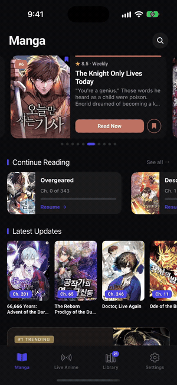

## What is this?

Siphon Zone is a mobile app (iOS/Android) where you can read manga, read novels, and watch live, 24/7 anime channels with no ads. The services, are made up of independent backend services that fetch data, cleans, and enriches content from across the web, stores it on a self-hosted media server, and serves it to the app through a single secure gateway.

It started in 2023 as a single Node.js app called **Siphon Manga** that only did one thing: read manga. Since then it's been rebuilt from the ground up into a 12 service distributed system, that run entirely on self-hosted infrastructure, with its own observability stack, background job queues, and an AI model for generating content descriptions. The rewrite was deliberate: each content type (manga / anime / novels) gets its own backend service to have a proper seperation of concerns.

<table align="center">
  <tr>
    <td align="center">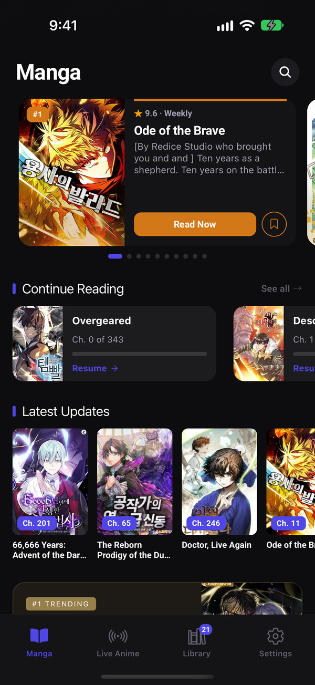 Manga home</td>
    <td align="center">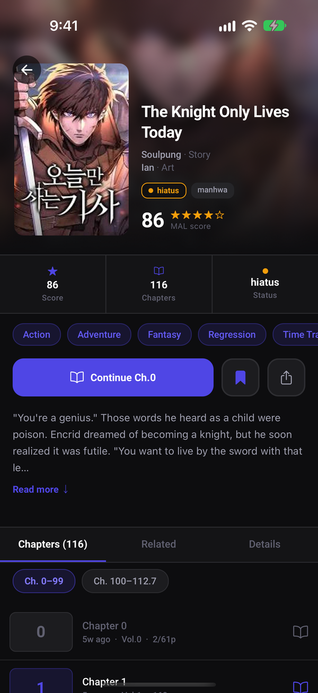 Manga detail</td>
    <td align="center">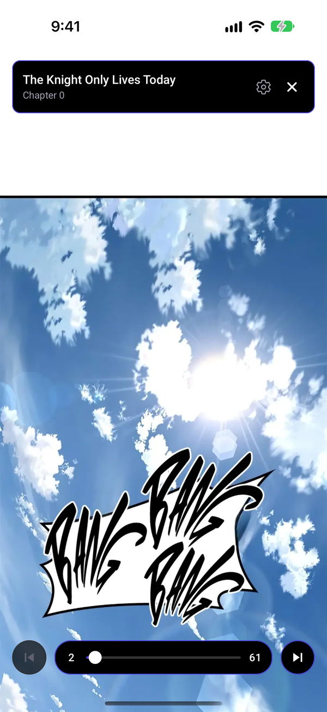 Reader</td>
    <td align="center">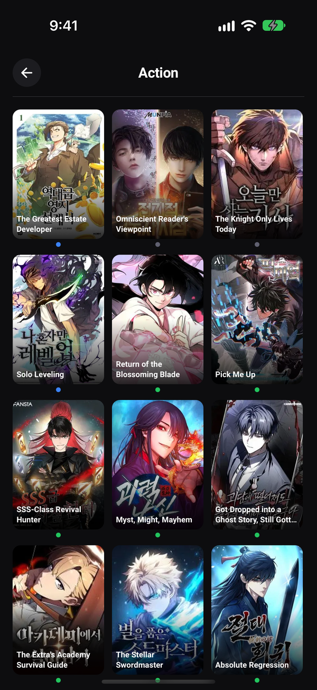 Browse</td>
  </tr>
  <tr>
    <td align="center">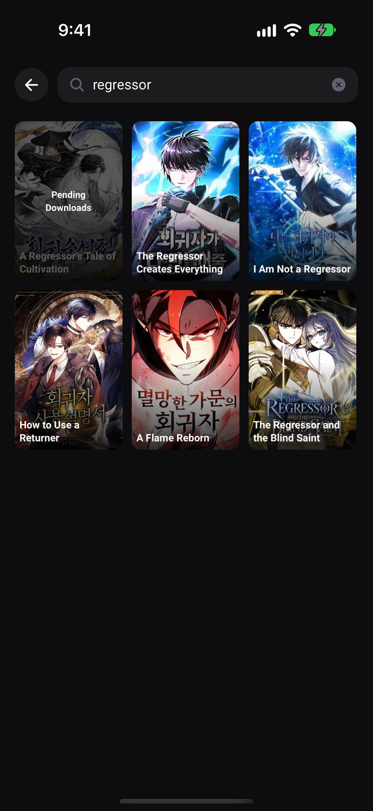 Search</td>
    <td align="center">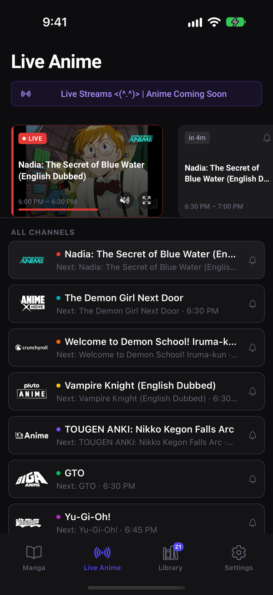 Live anime TV</td>
    <td align="center">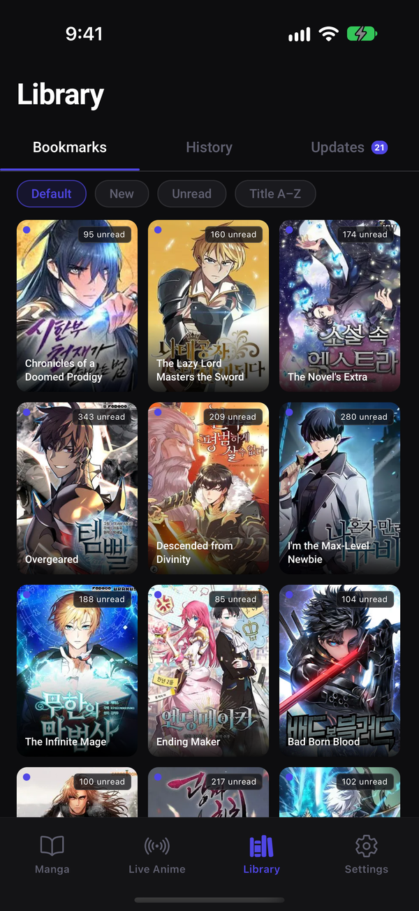 Library</td>
    <td align="center">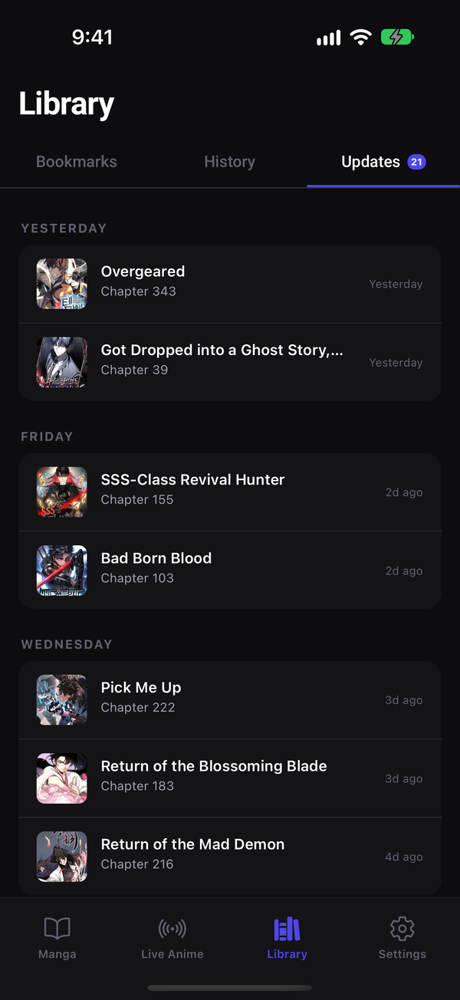 Library updates</td>
  </tr>
  <tr>
    <td align="center"> Continue reading</td>
    <td align="center">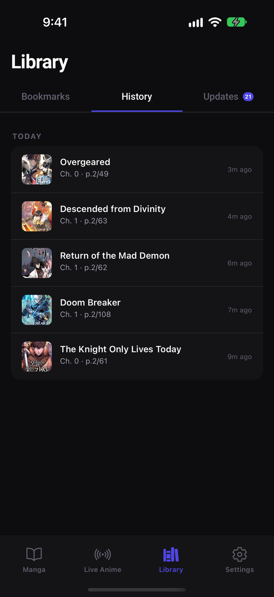 History</td>
    <td align="center">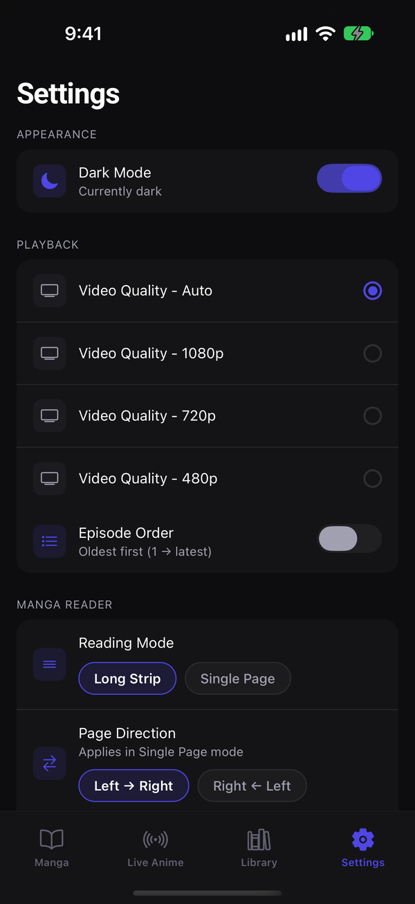 Settings (dark)</td>
    <td align="center">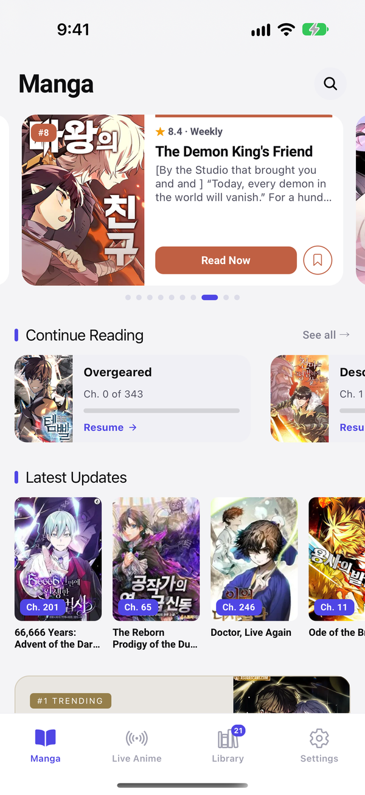 Light theme</td>
  </tr>
</table>

Full demo video: <a href="media/demo.mp4">demo.mp4</a>

## Why I built it this way

- **Polyglot microservices, on purpose.** 10+ backend services across TypeScript/NestJS, Java/Spring Boot, Go, and C#/.NET, all talking to the same PostgreSQL database and sharing API contracts generated from a single set of **Protocol Buffer** definitions so a schema change in one place regenerates typed clients for every language at once, I did this on purpose because alot of my other apps use different backend languages and this keeps my skills sharp.
- **Data fetching pipeline** Scrapers fall back through multiple strategies (direct HTTP - a pool of headless-Chrome FlareSolverr instances - Playwright) to get past Cloudflare bot-challenges, with tunable worker concurrency and automatic retry/backoff.
- **Background job processing, in two different ecosystems.** The manga scraper runs on **BullMQ/Redis** queues; the novel scraper (written in Go) runs on **Asynq** both handle thousands of chapter-download jobs with bounded concurrency instead of blocking request threads.
- **Cross-source identity resolution.** The same series often exists on multiple source sites under different names. A Jaccard token-similarity matcher reconciles titles against AniList/MyAnimeList/Kitsu IDs, cross-validates conflicting matches, and de-duplicates automatically a small but real data-matching/trust problem.
- **Self-hosted AI enrichment.** A locally-run **Ollama** LLM generates missing plot descriptions during metadata enrichment.
- **Real observability.** Centralized logs via **Grafana + Loki + Promtail**, plus a custom monitoring dashboard/API.
- **Production infra engineering** The whole stack runs on a self-hosted NAS via Docker Compose, with purpose-built deployment tooling: schema-readiness gating so services don't boot before their tables exist, scoped redeploys so a one-line manga fix doesn't rebuild the JVM services.
- **Edge-auth model.** The gateway verifies JWTs and resolves them to a device identity once, then passes a trusted header downstream. The internal services don't each re-implement auth, they trust the edge.

## Architecture

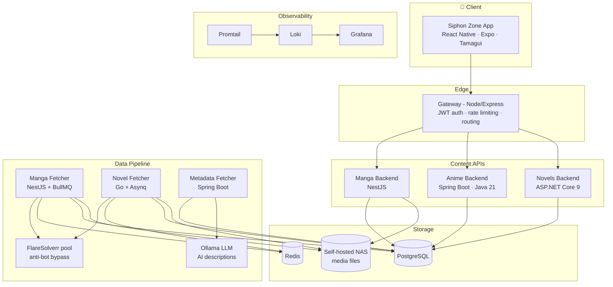

## The services

| Service | Stack | Role |
|---|---|---|
| **Siphon-Zone-App** | React Native, Expo, Tamagui, TanStack Query | Cross-platform iOS/Android client |
| **Siphon-Zone-Gateway** | Node.js, Express, JWT | Edge API gateway - auth, rate limiting, request routing |
| **Siphon-Zone-Manga-Backend** | NestJS, TypeScript | Manga catalog, search, reader, bookmarks & history |
| **Siphon-Zone-Anime-Backend** | Spring Boot, Java 21 | Anime catalog & live-TV channel API |
| **Siphon-Zone-Novels-Backend** | ASP.NET Core 9, C#, Dapper | Novel catalog & reader API |
| **Siphon-Zone-Data/Siphon-Zone-Manga** | NestJS, BullMQ, Playwright, Sharp | Data fetch, dedupes, and stores manga chapters |
| **Siphon-Zone-Data/Siphon-Zone-Novel** | Go, Asynq, Colly | Data fetch and stores novel chapters |
| **Siphon-Zone-Data/Siphon-Zone-MetaData** | Spring Boot, Java | Enriches series with AniList/MAL/Kitsu data + AI descriptions |
| **Siphon-Zone-Shared-Types** | Protocol Buffers | Single source of truth for API contracts across every language |
| **Siphon-Zone-Config** | Docker Compose, Grafana, Loki, Promtail | Infrastructure, observability, and deployment tooling |

## Distribution

Shipped to real users via [Apple TestFlight](https://developer.apple.com/testflight/) for iOS and signed APKs for Android.